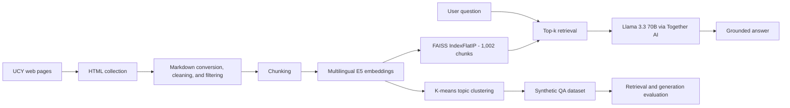

# UCY AI Assistant - Retrieval-Augmented Generation

> **MAI623 Natural Language Processing | University of Cyprus | Group project**

This repository documents a group exploration of Retrieval-Augmented Generation (RAG) for a conversational assistant that answers questions from official University of Cyprus (UCY) information. The team compared a foundational RAG implementation with higher-level LangChain/LangGraph and OpenAI Agents SDK approaches.

## Portfolio focus: my contribution

I am [Chrysis Andreou](https://github.com/ChrysisAndreou). This was a collaborative academic project, and this README intentionally foregrounds the part I designed and implemented: **ChrysisRagDeepThought**, an end-to-end RAG system built to understand the mechanics of retrieval, generation, and evaluation from first principles.

My work is contained primarily in [`ChrysisRagDeepThought_final/`](ChrysisRagDeepThought_final/). The other implementations, datasets, reports, and presentation files remain in the repository as group-project context; I do not claim sole authorship of those materials or of the overall team project.

### What I built

- **Web-data preprocessing pipeline:** collected UCY pages, converted HTML to Markdown, removed repeated navigation and footer content, normalized the text, and retained information-rich documents.
- **Core multilingual RAG engine:** chunked the cleaned corpus, embedded it with `intfloat/multilingual-e5-large-instruct`, indexed 1,002 chunks in FAISS, retrieved relevant passages with cosine-equivalent inner-product search, and generated grounded answers through Together AI.
- **Synthetic evaluation dataset:** clustered document embeddings with k-means (`k=31`) and sampled representative, diverse chunks before using an LLM to produce question-answer pairs and ranked relevant contexts.
- **Interactive assistant:** created the command-line **DeepThought** agent for questions about UCY.
- **Evaluation framework:** measured retrieval with Hit Rate, Mean Reciprocal Rank (MRR), Precision, and Kendall's Tau-b, and measured generation with semantic similarity.
- **Experiment analysis and reporting:** compared the original 42 automatically generated questions with a curated set of 33 clearer questions, produced plots, and documented the effect of question quality on downstream performance.

## DeepThought architecture



The implementation deliberately exposes each stage of the pipeline instead of hiding it behind a high-level RAG framework. That made model choice, chunking, normalization, retrieval behavior, prompt design, and evaluation directly inspectable.

## Results

The same system was evaluated with the full automatically generated dataset and with a manually curated subset of clearer questions.

| Evaluation set | Questions | Hit Rate @5 | MRR @5 | Precision @5 | Kendall's Tau-b @5 | Mean semantic similarity |
|---|---:|---:|---:|---:|---:|---:|
| Automatically generated | 42 | 0.7381 | 0.5877 | 0.3810 | 0.2460 | 0.9429 |
| Curated "good questions" | 33 | **0.8485** | **0.6490** | **0.3879** | **0.3091** | **0.9631** |

The curated questions improved Hit Rate @5 by about **11 percentage points** and increased answer similarity from **0.9429 to 0.9631**. The experiment showed that question quality affects both retrieval accuracy and the quality of the generated answer.


The underlying evidence is committed in the [automatic-question outputs](ChrysisRagDeepThought_final/output_for%20automatically%20generate%20questions/) and [curated-question outputs](ChrysisRagDeepThought_final/output_for%20good%20questions/).

## Run my implementation

The quickest path is the guided Colab notebooks in [`ChrysisRagDeepThought_final/`](ChrysisRagDeepThought_final/). To run the interactive agent locally:

```bash
cd ChrysisRagDeepThought_final/chrysisRagDeepThought_pre-run
python3 -m venv .venv
source .venv/bin/activate
pip install -r requirements.txt
unzip long_files.zip
export TOGETHER_API_KEY="your-key"
python 2_interactive_agent.py
```

To regenerate the dataset and evaluation outputs, run the numbered scripts in order:

```bash
python 1_dataset_pipeline.py
python 3_evaluate_retrieval.py
python 4_evaluate_generation.py
python 5_visualize_evaluation.py
```

The data-acquisition stage is documented separately in [`chrysisRagPreprocess/`](ChrysisRagDeepThought_final/chrysisRagPreprocess/) and requires web-scraping credentials. Preprocessed source material is included, so that stage can be skipped when exploring the RAG system. Model and service identifiers reflect the environment used for the 2025 course submission and may need to be updated if provider availability has changed.

## Repository guide

| Path | Purpose | Authorship context |
|---|---|---|
| [`ChrysisRagDeepThought_final/`](ChrysisRagDeepThought_final/) | Final DeepThought implementation, notebooks, evaluation outputs, and individual report | **My primary contribution** |
| [`chrysisIntialCode/`](chrysisIntialCode/) | Early prototype and initial exploration | My earlier iteration, retained to show the development process |
| [`constantinos_code/`](constantinos_code/) | OpenAI Agents SDK implementation | Teammate contribution |
| Other top-level code, notebooks, and datasets | LangChain/LangGraph experiments, data preparation, and supporting work | Group context and teammate contributions |
| [`incorporated feedback_MAI623-NLP_UCY-RAG chatbot_team report.pdf`](incorporated%20feedback_MAI623-NLP_UCY-RAG%20chatbot_team%20report.pdf) | Consolidated technical report comparing the three approaches | Collaborative team deliverable |

## Team context

The project team was **Mikhail Sumskoi, Marios Menelaou, Maria Tsilidou, Chrysis Andreou, and Constantinos Leonidou**. Together, the group explored three complementary paths:

1. A low-level, fully inspectable RAG pipeline - the focus of my DeepThought contribution.
2. A LangChain/LangGraph multi-tool agent backed by specialized data sources.
3. An OpenAI Agents SDK implementation with orchestration, state management, and LLM-based document grading.

This multi-track structure was an intentional learning strategy: understand the fundamentals first, then compare them with framework-based approaches designed for faster development and richer agentic behavior.

## Further documentation

- [Detailed DeepThought README](ChrysisRagDeepThought_final/README.md)
- [My individual technical report](ChrysisRagDeepThought_final/Report_ChrysisRagDeepThought.pdf)
- [Consolidated team report](incorporated%20feedback_MAI623-NLP_UCY-RAG%20chatbot_team%20report.pdf)

---

Academic project developed for MAI623 Natural Language Processing at the University of Cyprus.
